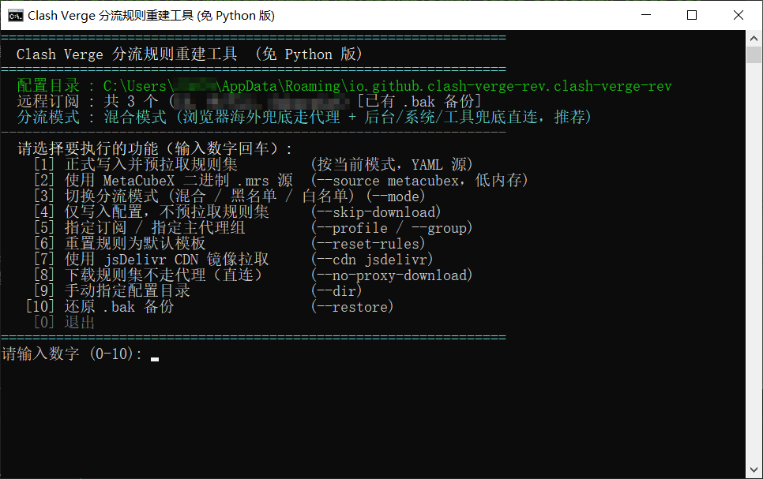

# clash_rebuild_rules

一键重建 **Clash Verge (Rev)** 所有远程订阅的分流规则：自动屏蔽机场自带的老旧/杂乱规则，统一替换为每日自动更新的开源规则集（支持 [Loyalsoldier/clash-rules](https://github.com/Loyalsoldier/clash-rules) 与 [MetaCubeX/meta-rules-dat](https://github.com/MetaCubeX/meta-rules-dat)），并采用**浏览器海外兜底代理 + 后台进程兜底直连**的混合分层策略，同时解决“后台软件偷跑代理流量”与“浏览器冷门海外站连不上”两大痛点。

> **免安装开箱即用**：Windows 用户无需安装 Python，直接双击 `clash_rebuild_rules.bat` 按数字即可完成配置；macOS / Linux 用户可使用跨平台 Python 版。

---

## 核心特性

- **批量统一所有远程订阅**：自动扫描 Clash Verge 中的全部远程订阅并识别各自的主代理组（兼容 ACL4SSR 等多分组订阅），一次写入所有订阅，无需逐个手动调整。
- **三种分流模式随时切换（默认 `hybrid` 混合模式）**：兼顾省流量与开箱可用，也支持按需切换为纯黑名单（`blacklist`）或经典白名单（`whitelist`）。
- **界面可见、可改、重跑不丢自定义规则**：采用 **Merge + Rules 增强分离写入**，所有生效规则直接在 Clash Verge **「右键订阅 → 编辑规则」** 中可见可编辑；自动补齐 `find-process-mode: always` 以支持进程识别与流量监控；重跑或切换模式时自动清理另一模式未用的规则集，并**无损保留**你在界面中手工新增的自定义规则与自定义 provider。
- **双规则源 + 带进度条预拉取**：支持易读易排查的 Loyalsoldier YAML 源与体积小、启动快、低内存的 MetaCubeX 二进制 `.mrs` 源；写入时自动预下载全部规则集到本地缓存，避免首次启动拉取超时。
- **自动备份、一键还原**：首次修改前自动保存 `.bak` 备份，随时通过 `--restore` 或菜单 `[10]` 一键恢复原配置。

---

## 三种分流模式对比

| 模式 | 兜底策略 | 浏览器访问冷门海外站 | 系统 / IDE / 后台工具防偷跑 | 规则数（MetaCubeX `.mrs` 体积） | 适用场景 |
| :--- | :--- | :--- | :--- | :--- | :--- |
| **`hybrid`（默认推荐）** | 浏览器海外兜底代理<br>非浏览器 `MATCH,DIRECT` | **自动走代理**（国内站与国内 IP 直连） | **自动直连**（Google / AI / GFW / Telegram 仍走代理） | 37 条（13 份，约 616 KB） | **绝大多数用户的首选**：刷网页不操心、后台不偷跑 |
| **`blacklist`** | 全局 `MATCH,DIRECT` | 仅已收录的被墙 / Google / AI / Telegram 走代理 | **极简直连**，最省流量与内存 | 12 条（7 份，约 55 KB） | 极度追求低内存/省流量，愿意按需手动补代理域名 |
| **`whitelist`** | 全局 `MATCH,PROXY` | **自动走代理** | 仅直连清单与国内 IP 直连，未入表海外流量会走代理 | 27 条（10 份，约 820 KB） | 希望所有未识别海外连接默认走代理的传统习惯 |

---

## 快速开始

### 方式一：Windows 双击交互菜单（推荐，免装 Python）

依赖 Windows 10/11 自带 PowerShell，**零外部依赖**。直接双击 `clash_rebuild_rules.bat`，按数字回车即可（默认混合模式；推荐选 `[2]` → `[2]` 使用 MetaCubeX `.mrs` + jsDelivr）：



菜单功能一览：

| 序号 | 功能 | 对应命令行参数 |
| :---: | :--- | :--- |
| `[1]` | 正式写入并预拉取规则集（按当前模式，Loyalsoldier YAML 源） | 默认行为 |
| `[2]` | 使用 MetaCubeX 二进制 `.mrs` 源（可选 GitHub 或 jsDelivr） | `--source metacubex` |
| `[3]` | 切换分流模式：`hybrid` / `blacklist` / `whitelist` | `--mode <模式>` |
| `[4]` | 仅写入配置，不预拉取规则集 | `--skip-download` |
| `[5]` | 指定订阅 / 指定主代理组 | `--profile` / `--group` |
| `[6]` | 重置规则为默认模板（不保留界面手工规则） | `--reset-rules` |
| `[7]` | 使用 jsDelivr CDN 镜像拉取 | `--cdn jsdelivr` |
| `[8]` | 下载规则集不走代理（直连） | `--no-proxy-download` |
| `[9]` | 手动指定配置目录 | `--dir <目录>` |
| `[10]` | 用 `.bak` 还原所有订阅配置 | `--restore` |

同样支持直接在命令行带参数运行，例如：

```powershell
clash_rebuild_rules.bat --source metacubex --cdn jsdelivr
clash_rebuild_rules.bat --mode blacklist --source metacubex
clash_rebuild_rules.bat --restore
```

### 方式二：Python 命令行版（Windows / macOS / Linux）

需要 Python 3.7+ 与 `PyYAML`，会自动识别各系统下的 Clash Verge (Rev) 配置目录：

```bash
pip install pyyaml
```

```bash
# 推荐：混合模式 (hybrid) + MetaCubeX 二进制 .mrs 源 + jsDelivr 镜像
python clash_rebuild_rules.py --source metacubex --cdn jsdelivr

# 默认应用：混合模式 (hybrid) + Loyalsoldier YAML 源
python clash_rebuild_rules.py

# 切换分流模式（纯黑名单 / 经典白名单）
python clash_rebuild_rules.py --mode blacklist --source metacubex
python clash_rebuild_rules.py --mode whitelist --source metacubex

# 仅处理指定订阅或手动指定主代理组
python clash_rebuild_rules.py --profile "订阅名称" --group "节点选择"

# 只写配置不预拉取 / 重置界面手工规则 / 下载不走代理 / 指定配置目录
python clash_rebuild_rules.py --skip-download
python clash_rebuild_rules.py --reset-rules
python clash_rebuild_rules.py --no-proxy-download
python clash_rebuild_rules.py --dir "D:\path\to\clash-verge-config"

# 用首次生成的 .bak 备份一键还原
python clash_rebuild_rules.py --restore
```

<details>
<summary>查看完整命令行参数表（<code>.py</code> 与 <code>.bat</code> 参数完全一致）</summary>

| 参数 | 说明 |
| :--- | :--- |
| `--mode {hybrid,blacklist,whitelist}` | 分流模式，默认 `hybrid` |
| `--source {loyalsoldier,metacubex}` | 规则集源：`loyalsoldier`（YAML，默认）或 `metacubex`（`.mrs` 低内存） |
| `--cdn {raw,jsdelivr}` | 规则下载地址：`raw`（GitHub，默认）或 `jsdelivr`（国内 CDN 镜像） |
| `--profile <名称/uid/文件名>` | 仅处理指定订阅，可重复指定多次 |
| `--group <代理组名>` | 手动指定目标主代理组名，覆盖自动识别 |
| `--skip-download` | 只写配置文件，不预先拉取规则集到本地 `ruleset/` 缓存 |
| `--no-proxy-download` | 规则集不指定 `proxy` 且预拉取不走系统代理（境外网络或直连镜像用） |
| `--reset-rules` | 重置 Rules 增强为模板默认规则，不保留界面手工新增规则 |
| `--dir <目录>` | 手动指定 Clash Verge 配置目录（也可设置环境变量 `CLASH_VERGE_DIR`） |
| `--restore` | 使用首次修改前生成的 `.bak` 备份还原所有订阅的 Merge 与 Rules 文件 |

</details>

---

## 生效步骤与最佳实践

1. **重新加载生效**：运行脚本后，打开 **Clash Verge → 订阅（Profiles）**，点击当前激活的订阅卡片重新加载（或点击右上角重启内核）。
2. **查看与微调规则**：右键订阅 → **「编辑规则」**，顶部无删除线的条目为当前生效规则，下方带红色删除线的为已屏蔽的原订阅旧规则。
   - 混合模式默认覆盖 `chrome.exe`、`msedge.exe`、`ego.exe`、`firefox.exe`、`brave.exe`、`arc.exe`；若使用其它浏览器，直接在「编辑规则」顶部补充 `PROCESS-NAME,你的浏览器.exe,主代理组` 即可。
   - 若某浏览器下载大文件时遇到未收录的海外 CDN，或某非浏览器工具需要走代理，直接添加一条 `DOMAIN-SUFFIX` / `PROCESS-NAME` 自定义规则，后续重跑脚本会自动保留。
3. **DNS 覆盖建议（重要）**：
   - 在 Clash Verge 的 **「设置 → DNS 覆盖」** 中，建议将 `nameserver` 与 `direct-nameserver` **仅保留国内加密 DoH**，移除明文 `8.8.8.8`（避免 UDP 53 污染或国内/双栈 CDN 被抢答解析到海外 IP 而绕过 `GEOIP,CN`）：
   - 请在 Clash Verge 的 DNS 覆盖面板中配置，**不要**写入 Merge 文件（否则会被 `AuthoritativeFields` 丢弃）。

<details>
<summary>推荐的 Clash Verge「DNS 覆盖」关键配置参考</summary>

```yaml
dns:
  enable: true
  enhanced-mode: fake-ip
  default-nameserver:
    - 223.5.5.5
    - 119.29.29.29
  nameserver:
    - https://doh.pub/dns-query
    - https://dns.alidns.com/dns-query
  direct-nameserver:
    - https://doh.pub/dns-query
    - https://dns.alidns.com/dns-query
  proxy-server-nameserver:
    - https://doh.pub/dns-query
    - https://dns.alidns.com/dns-query
  fallback: []
```

> 说明：在 `fake-ip` 模式下，命中域名代理规则（`google` / `ai` / `gfw` / `telegram` 等）的流量直接以域名交由远端节点解析；而直连流量通过国内加密 DoH 解析，可获得离国内最近的 CDN 边缘节点。

</details>

4. **Steam / Bing 提示**：
   - Bing 搜索与 Steam 游戏下载 CDN 默认直连，Steam 商店/社区（`store.steampowered.com` / `steamcommunity.com`）已包含在 `gfw` 中自动走代理。
   - 若 Steam 此前锁定过海外下载地区，请在 **Steam → 设置 → 下载 → 下载地区** 切回国内城市并重启。

---

## 分流规则说明

Clash 按从上到下顺序匹配，**命中第一条即停止**（`{group}` 自动替换为各订阅自身的主代理组）。

### 混合模式（`--mode hybrid`，默认，37 条）

| 顺序 | 规则 | 策略 | 说明 |
| :---: | :--- | :---: | :--- |
| 1 | `RULE-SET,private` | `DIRECT` | 局域网 / 私有域名直连 |
| 2–3 | `DOMAIN-SUFFIX,gvt2.com`、`DOMAIN,statsig.anthropic.com` | `{group}` | 放行 Chrome 组件更新与 Claude 特性开关（防 `reject` 误杀） |
| 4 | `RULE-SET,reject` | `REJECT` | 广告与追踪域名拦截 |
| 5–8 | `bing.com` / `bing.net` / `bingapis.com` / `bingj.com` | `DIRECT` | Bing 国内搜索、联想 API、静态资源与快照直连 |
| 9–13 | `steamcontent.com` / `steamserver.net` / `steamchina.com` / `st.dl.pinyuncloud.com` / `steampipe.akamaized.net` | `DIRECT` | Steam 游戏本体/更新 CDN 与 CM 连接直连 |
| 14–15 | `qoder.sh` / `traecdn.us` | `DIRECT` | Qoder API 与 Trae 国际版静态资源/安装包 CDN 直连 |
| 16–17 | `RULE-SET,icloud` / `RULE-SET,apple` | `DIRECT` | iCloud 与 Apple 国内 CDN 直连 |
| 18–19 | `RULE-SET,google` / `DOMAIN-SUFFIX,gstatic.cn` | `{group}` | Google 全家桶（含 YouTube / `googleapis` / `gstatic` 等）走代理 |
| 20 | `RULE-SET,ai` | `{group}` | 海外 AI 服务（OpenAI / Claude / Cursor / Copilot / Gemini / Perplexity / Grok 等）走代理 |
| 21 | `RULE-SET,gfw` | `{group}` | GFW 被墙域名（GitHub / X / Reddit / Discord / Steam 商店与社区等）走代理 |
| 22 | `RULE-SET,telegram` | `{group}` | Telegram 域名走代理 |
| 23 | `DOMAIN-SUFFIX,challenges.cloudflare.com` | `{group}` | Cloudflare 人机验证走代理，避免与代理站点出口 IP 不一致导致 Turnstile 失败 |
| 24 | `RULE-SET,telegramcidr` (`no-resolve`) | `{group}` | Telegram 纯 IP 连接走代理（免 DNS 解析） |
| 25 | `RULE-SET,microsoftcn` | `DIRECT` | 微软中国 / Windows 更新与 CN 服务直连（置于 `gfw`/`ai` 之后，不误伤 Copilot/OneDrive） |
| 26 | `RULE-SET,direct` | `DIRECT` | 国内网站与常用下载 CDN 直连（优先于浏览器海外兜底） |
| 27–30 | `RULE-SET,lancidr` / `cncidr` (`no-resolve`)、`GEOIP,LAN` / `CN` | `DIRECT` | 局域网与中国大陆 IP 直连 |
| 31–36 | `PROCESS-NAME`（`chrome.exe` / `msedge.exe` / `ego.exe` / `firefox.exe` / `brave.exe` / `arc.exe`） | `{group}` | 浏览器未命中国内规则/国内 IP 的冷门海外站自动走代理 |
| 37 | `MATCH` | `DIRECT` | 非浏览器系统/后台/IDE/桌面工具其余未命中流量默认直连，杜绝偷跑 |

<details>
<summary>展开查看：黑名单模式（<code>--mode blacklist</code>，12 条）与白名单模式（<code>--mode whitelist</code>，27 条）完整规则表</summary>

#### 黑名单模式（`--mode blacklist`，12 条）

| 顺序 | 规则 | 策略 | 说明 |
| :---: | :--- | :---: | :--- |
| 1 | `RULE-SET,private` | `DIRECT` | 局域网 / 私有域名直连 |
| 2–3 | `DOMAIN-SUFFIX,gvt2.com`、`DOMAIN,statsig.anthropic.com` | `{group}` | 放行 Chrome 组件更新与 Claude 特性开关（防 `reject` 误杀） |
| 4 | `RULE-SET,reject` | `REJECT` | 广告与追踪域名拦截 |
| 5–6 | `RULE-SET,google` / `DOMAIN-SUFFIX,gstatic.cn` | `{group}` | Google 全家桶走代理 |
| 7 | `RULE-SET,ai` | `{group}` | 海外 AI 服务（OpenAI / Claude / Cursor / Copilot / Gemini 等）走代理 |
| 8 | `RULE-SET,gfw` | `{group}` | GFW 被墙域名走代理 |
| 9 | `RULE-SET,telegram` | `{group}` | Telegram 域名走代理 |
| 10 | `DOMAIN-SUFFIX,challenges.cloudflare.com` | `{group}` | Cloudflare 人机验证走代理 |
| 11 | `RULE-SET,telegramcidr` (`no-resolve`) | `{group}` | Telegram 纯 IP 连接走代理 |
| 12 | `MATCH` | `DIRECT` | 其余全部默认直连 |

#### 白名单模式（`--mode whitelist`，27 条）

| 顺序 | 规则 | 策略 | 说明 |
| :---: | :--- | :---: | :--- |
| 1 | `RULE-SET,private` | `DIRECT` | 局域网 / 私有域名直连 |
| 2–3 | `DOMAIN-SUFFIX,gvt2.com`、`DOMAIN,statsig.anthropic.com` | `{group}` | 放行 Chrome 组件更新与 Claude 特性开关（防 `reject` 误杀） |
| 4 | `RULE-SET,reject` | `REJECT` | 广告与追踪域名拦截 |
| 5–8 | `bing.com` / `bing.net` / `bingapis.com` / `bingj.com` | `DIRECT` | Bing 国内搜索、联想 API、静态资源与快照直连 |
| 9–13 | `steamcontent.com` / `steamserver.net` / `steamchina.com` / `st.dl.pinyuncloud.com` / `steampipe.akamaized.net` | `DIRECT` | Steam 游戏下载/更新 CDN 与 CM 连接直连 |
| 14–15 | `qoder.sh` / `traecdn.us` | `DIRECT` | Qoder API 与 Trae 国际版静态资源/安装包 CDN 直连 |
| 16–17 | `RULE-SET,icloud` / `RULE-SET,apple` | `DIRECT` | iCloud 与 Apple 国内 CDN 直连 |
| 18–19 | `RULE-SET,google` / `DOMAIN-SUFFIX,gstatic.cn` | `{group}` | Google 大陆可直连域名与 `gstatic.cn` 强制走代理 |
| 20 | `RULE-SET,gfw` | `{group}` | GFW 被墙域名走代理 |
| 21 | `RULE-SET,direct` | `DIRECT` | 国内网站与微软 / 游戏 / 驱动下载 CDN 直连 |
| 22 | `RULE-SET,proxy` | `{group}` | 海外常见服务走代理 |
| 23–26 | `RULE-SET,lancidr` / `cncidr` (`no-resolve`)、`GEOIP,LAN` / `CN` | `DIRECT` | 局域网与中国大陆 IP 直连 |
| 27 | `MATCH` | `{group}` | 其余未命中流量默认走主代理组兜底 |

</details>

---

## 实现细节与仓库结构

- **Merge + Rules 分离写入**：Merge 增强仅负责当前模式所需的 `rule-providers`（`interval: 86400`，自动清理其它模式未用的托管规则集）并在未设置时补齐 `find-process-mode: always`，不触碰 `rules` 和 `dns`；Rules 增强将分流规则写入 `prepend`，并用 `delete` 屏蔽机场原规则。
- **跨模式切换无损保留手工规则**：脚本托管规则与手工自定义规则按规则键隔离，在 `hybrid`、`blacklist`、`whitelist` 三种模式之间自由切换时，不会把旧模式模板误留为自定义规则，也不会丢失界面手工规则。
- **仓库文件**：
  - `clash_rebuild_rules.bat`：Windows 免 Python 独立版（内置纯 PowerShell YAML 解析/序列化与交互式菜单，兼容全部命令行参数）。
  - `clash_rebuild_rules.py`：跨平台 Python 主脚本，与 `.bat` 生成完全一致的 Merge + Rules 增强配置。
  - `docs/bat-preview.png`：Windows 交互式菜单运行预览图。
